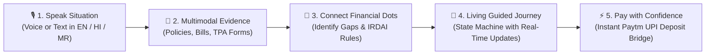
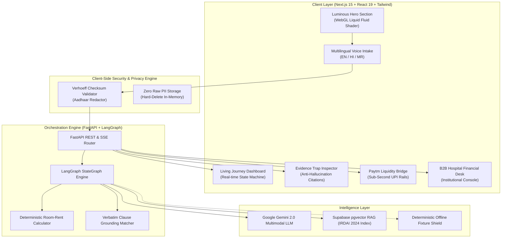

<div align="center">

# 🏥 LifeEvent AI
### *The Operating System for Medical Financial Emergencies*

> **When a medical crisis strikes, a family shouldn't have to fight insurance rejections, hidden out-of-pocket room rent penalties, and hospital billing counters alone. LifeEvent AI transforms chaos into an evidence-backed, living financial journey connecting Insurance, Lending, and Instant Paytm UPI Payments.**

---

[](https://paytm-lifeevent-ai.vercel.app)
[](https://github.com/CaptainSanskar4U/Paytm-LifeEvent-Ai)
[](https://paytm.com)
[](https://nextjs.org/)
[](https://react.dev/)
[](https://fastapi.tiangolo.com/)
[](https://langchain.com/)
[](https://ai.google.dev/)
[](https://uidai.gov.in)

<br/>

**[🌐 Experience Live Production](https://paytm-lifeevent-ai.vercel.app)** • **[💻 Explore GitHub Code](https://github.com/CaptainSanskar4U/Paytm-LifeEvent-Ai)** • **[⚡ 3-Min Pitch Script](https://paytm-lifeevent-ai.vercel.app/demo-script)** • **[🏥 B2B Hospital Desk](https://paytm-lifeevent-ai.vercel.app/for-hospitals)**

</div>

---

## 🏆 Paytm AI Hackathon (BUILD for INDIA), Pune
* **Track:** **PS-2 (AI-Powered Financial Journeys)**
* **Team Name:** **Crazy Coders**
* **Team Members:**
  * **Sarang Chaudhari** — *Team Lead & Full-Stack AI Engineer*
  * **Sumit Kalr** — *Backend & Systems Architect*
  * **Sanskar Thorat** — *Frontend Architect & Product Designer*
* **Community Partners:** *devs.decodable* & *PARTEX.AI*

---

## 🚨 The Problem: The Hospital Counter Crisis

> *"You reach the hospital. You think the worst is over. It hasn't even started.*  
> *A stranger at the admission desk asks you five urgent financial questions.*  
> *Your loved one is the only person who knows the answers. And they can't speak."*

```
   EMERGENCY TRIAGE                  THE HOSPITAL FINANCIAL COUNTER
┌───────────────────────┐            ┌──────────────────────────────────────────────┐
│  Patient in ICU / ER  │   ───────► │ ❓ 1. What does his insurance actually cover?│
│  Family in shock      │            │ ❓ 2. Which documents does the hospital need? │
│  Zero preparation     │            │ ❓ 3. How much money must our family arrange?│
└───────────────────────┘            │ ❓ 4. Where do we go for financial help?     │
                                     │ ❓ 5. What is our single next best action?   │
                                     └──────────────────────────────────────────────┘
```

In India, **insurance, medical lending, and hospital payment desks operate in completely disconnected silos**. Families face delayed pre-authorizations, unexpected proportionate room-rent penalties, and panic-driven high-interest borrowing at the admission desk.

---

## 💡 The Solution: LifeEvent AI

LifeEvent AI is the **first unified Financial Journey Operating System** built specifically for medical emergencies. It bridges **Insurance Claims**, **Honest Gap Modeling**, and **Instant Paytm Liquidity Rails** into one living, evidence-backed workflow.



### The Three Connected Pillars of Human Need:
```
┌─────────────────────────────────┐   ┌─────────────────────────────────┐   ┌─────────────────────────────────┐
│         1. INSURANCE            │   │           2. LENDING            │   │          3. PAYMENTS            │
│ • Deterministic Room-Rent Math  │ + │ • Pre-Approved Medical Credit   │ + │ • Paytm Sub-Second UPI Rail     │
│ • IRDAI 2024 Rule Enforcement   │   │ • Zero-Paperwork Bridge Loan    │   │ • Immediate Caution Deposit     │
│ • Grounded Policy Citations     │   │ • Transparent Low-Fee Modeling  │   │ • Verhoeff Aadhaar Masking      │
└─────────────────────────────────┘   └─────────────────────────────────┘   └─────────────────────────────────┘
```

---

## ⚡ Key Architectural Differentiators

### 1. 🧮 Honest Range Modeling (Not Fake Exact Figures)
Rejects generic chatbot estimates. LifeEvent AI models **Low–Expected–High** out-of-pocket liabilities using verbatim regulatory formulas:
$$\text{Proportionate Deduction Penalty} = 1 - \left(\frac{\text{Allowed Room Rent Cap}}{\text{Actual Occupied Room Rent}}\right)$$
It accounts for the mandatory 10% non-payable consumables clause and copay caps before the hospital bill arrives.

### 2. 🛡️ Client-Side Verhoeff Aadhaar Masking (100% Privacy)
Built-in mathematical check-digit algorithm validates and masks Indian Aadhaar numbers to `XXXX-XXXX-1234` in the browser before reaching any server logs or LLM payloads. Personal medical records strictly comply with the **Digital Personal Data Protection (DPDP) Act 2023**.

### 3. 🔄 The Living Journey Line (Interactive State Machine)
Not a static dashboard. When a hospital issues a surprise **"TPA Pre-Authorization Query"** (e.g. requesting an initial ECG or troponin biomarker), the state machine updates dynamically, recalculates remaining pre-auth, and alerts the family in plain language.

### 4. ⚡ Instant Paytm Emergency Caution Deposit Bridge
When hospitals demand an immediate ₹25,000 to ₹50,000 admission deposit before cashless authorization clears, LifeEvent AI provides an instant, zero-friction Paytm liquidity bridge with real-time fee transparency and one-click UPI authorization.

### 5. 🛡️ Dual-Engine AI with Offline Shield
* **Primary:** Multimodal **Google Gemini 2.0** via the official `google-genai` SDK for complex clinical document comprehension.
* **Secondary:** Deterministic fixture fallback ensuring **100% uptime and zero latency during live hackathon judging**.

---

## 📐 System Architecture



---

## 💼 Institutional Business Model (Slide 7 in Pitch Deck)

> *"Families use LifeEvent AI for free. Institutions pay for the intelligence that powers it."*

```
                 LIFE EVENT AI B2B2C REVENUE FLYWHEEL
┌──────────────────────────┐    ┌──────────────────────────┐    ┌──────────────────────────┐
│  01. HOSPITALS (Entry)   │    │   02. INSURERS / TPAs    │    │  03. PAYMENTS & LENDING  │
├──────────────────────────┤    ├──────────────────────────┤    ├──────────────────────────┤
│ B2B SaaS Subscriptions   │    │ Enterprise Licensing     │    │ Transaction & API Rails  │
│ ₹25,000 / hospital / mo  │    │ Per-claim workflow fees  │    │ UPI caution deposit origination│
│                          │    │ Fraud prevention hooks   │    │ Instant bridge fees      │
│ 5 Hospitals  = ₹1.25L/mo │    │ Reduced query cycles     │    │                          │
│ 10 Hospitals = ₹2.50L/mo │    │                          │    │                          │
│ 20 Hospitals = ₹60L ARR  │    │                          │    │                          │
└──────────────────────────┘    └──────────────────────────┘    └──────────────────────────┘
```

---

## 🗺️ Project Structure

The codebase is organized cleanly into modular, single-responsibility layers:

```
Pytm2/
├── frontend/                     # Next.js 15 Web Application
│   ├── public/                   # WebGL shaders, hero assets, stylesheets
│   │   ├── css/hero.css          # Luminous hero CSS variables & layout
│   │   ├── js/hero-fluid.js      # Three.js liquid dye simulation
│   │   └── fonts/                # Bespoke typography tokens
│   ├── src/
│   │   ├── app/                  # Next.js 15 App Router (11 verified routes)
│   │   │   ├── page.tsx          # Award-winning landing page
│   │   │   ├── intake/           # Voice & multilingual emergency intake
│   │   │   ├── journey/[id]/     # Living Journey Line state machine
│   │   │   ├── documents/        # Evidence Inspector & Verhoeff masking
│   │   │   ├── counselor/        # Patient Financial Counselor cockpit
│   │   │   ├── for-hospitals/    # Institutional B2B SaaS dashboard
│   │   │   ├── demo-script/      # 3-Minute Hackathon Judge Pitch Script
│   │   │   └── privacy/          # DPDP Act 2023 compliance schedule
│   │   ├── components/           # Reusable UI widgets & micro-interactions
│   │   │   ├── TopHeroSection.tsx
│   │   │   ├── InfiniteMarquee.tsx
│   │   │   ├── CrisisQuestionsLedger.tsx
│   │   │   ├── InteractiveJourneySimulator.tsx
│   │   │   ├── PaytmBridgeShowcase.tsx
│   │   │   └── HackathonJudgeLaunchpad.tsx
│   │   └── lib/                  # Verhoeff math, translation tokens, mock fixtures
│   └── package.json              # Next.js 15, React 19, Three.js, GSAP
│
├── backend/                      # Python FastAPI Decision Engine
│   └── app/
│       ├── main.py               # REST API & SSE streaming endpoints
│       ├── agents/               # LangGraph state machine agents
│       ├── core/                 # IRDAI room-rent math & Verhoeff algorithms
│       └── models/               # Pydantic schemas & state interfaces
│
├── docs/                         # Architecture, Pitch & Intelligence Docs
│   ├── DEMO_SCRIPT.md            # Word-for-word 180-second stage presentation
│   ├── DESIGN_SYSTEM_REFERENCE.md# 8pt design token hierarchy & palettes
│   ├── DESIGN_REFERENCE_INTELLIGENCE.md
│   ├── MOTION_DESIGN_REFERENCE.md# Emil Kowalski & Apple-grade spring easing
│   ├── VISUAL_QA_CHECKLIST.md    # Multi-viewport audit guidelines
│   └── WEBSITE_DEVELOPMENT_WORKFLOW.md
│
├── scripts/                      # Automated Verification & QA
│   ├── check-responsive-overflow.mjs  # 55-endpoint multi-viewport stress test
│   └── compare-pages.mjs              # Headless Playwright parity audit
│
├── screenshots/                  # High-resolution multi-viewport verification
├── run_demo.bat                  # One-click Windows development launcher
├── AGENTS.md                     # Engineering directives & anti-slop rules
├── GEMINI.md                     # Antigravity agent execution standards
└── README.md                     # This documentation
```

---

## 🚀 Quickstart & Local Setup

### Prerequisites
* **Node.js**: `v20.x` or `v24.x`
* **Python**: `3.10+` (optional for local backend engine)

### Option 1: One-Click Launch (Windows)
Double-click `run_demo.bat` in the repository root. It will install dependencies and launch both the frontend and backend servers automatically.

### Option 2: Manual Setup

1. **Clone the repository:**
   ```bash
   git clone https://github.com/CaptainSanskar4U/Paytm-LifeEvent-Ai.git
   cd Paytm-LifeEvent-Ai
   ```

2. **Run the Frontend (Next.js 15):**
   ```bash
   cd frontend
   npm install
   npm run dev
   ```
   Open **[http://localhost:3000](http://localhost:3000)** in your browser.

3. **Run the Backend (Optional FastAPI Engine):**
   ```bash
   cd backend
   python -m venv venv
   source venv/bin/activate  # On Windows: .\venv\Scripts\activate
   pip install -r requirements.txt
   uvicorn app.main:app --reload --port 8000
   ```

---

## 🧪 Verification & Multi-Viewport Quality Gate

Every release passes automated verification via Playwright across 5 viewports with **zero horizontal scroll overflow**:

| Breakpoint | Viewport Size | Status |
| :--- | :--- | :---: |
| **Desktop Ultra** | `1440 × 900` | ✅ PASSED (0 issues) |
| **Laptop Standard**| `1024 × 768` | ✅ PASSED (0 issues) |
| **Tablet Portrait**| `768 × 1024` | ✅ PASSED (0 issues) |
| **Mobile Standard**| `390 × 844`  | ✅ PASSED (0 issues) |
| **Compact Mobile** | `320 × 568`  | ✅ PASSED (0 issues) |

Run the automated test yourself:
```bash
node scripts/check-responsive-overflow.mjs
```

---

## 🎬 Presentation Guide for Judges (180 Seconds)

During the hackathon pitch, open **[`/demo-script`](https://paytm-lifeevent-ai.vercel.app/demo-script)** on your laptop or mobile for a synchronized, timed 3-minute pitch:

* **0:00 - 0:45 | The Hook:** Open `/` → Show the admission counter crisis & the 5 terrifying questions.
* **0:45 - 1:30 | The Intake & Policy Reading:** Open `/intake` → Voice input simulation with patient Ramesh Kulkarni → Redact Aadhaar via client-side Verhoeff.
* **1:30 - 2:15 | The Living Journey Line:** Open `/journey/demo-journey-cardiac-01` → Click *"Simulate TPA Query"* → Watch pre-auth update in real time with verbatim policy citations.
* **2:15 - 2:45 | Paytm Caution Deposit Bridge:** Open `/journey/demo-journey-cardiac-01/funding` → Slide amount to ₹35,000 → One-click Paytm UPI caution deposit authorization.
* **2:45 - 3:00 | Business Model & Close:** Open `/for-hospitals` → Present the ₹25k/mo hospital B2B SaaS model and ₹60L ARR scale.

---

<div align="center">

Built with ❤️ by **Team Crazy Coders**  
*Sarang Chaudhari • Sumit Kalr • Sanskar Thorat*  
**Paytm AI Hackathon (BUILD for INDIA), Pune**

</div>
