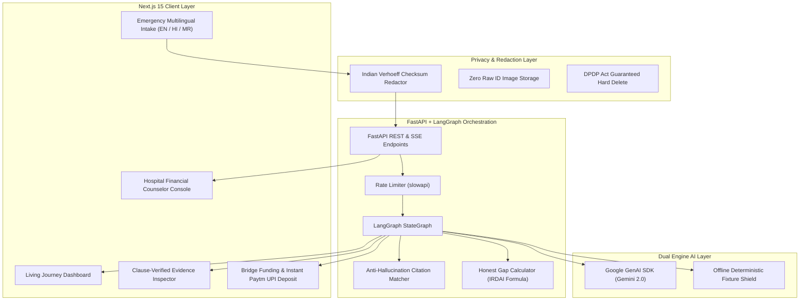

# LifeEvent AI 🏥💳

> **One guided financial journey connecting insurance claims, honest out-of-pocket gap calculations, and emergency payments when medical crises strike Indian families.**

[](https://nextjs.org/)
[](https://react.dev/)
[](https://fastapi.tiangolo.com/)
[](https://langchain.com/)
[](https://ai.google.dev/)
[](backend/tests/)
[](LICENSE)

---

### Paytm AI Hackathon (Build for India), Pune — PS-2: AI-Powered Financial Journeys
**Team Crazy Coders:**
- **Sarang Chaudhari** (Team Lead & Full-Stack AI Engineer)
- **Sumit Kalr** (Backend & Systems Architect)
- **Sanskar Thorat** (Frontend & Product Designer)

---

## The Problem: The Hospital Counter Crisis

When a family member is rushed to an emergency triage, the patient cannot speak. At the hospital admission desk, a shocked family attendant is hit with five high-stakes financial questions they cannot answer:

1. **What does insurance cover?**
2. **Which documents does the hospital TPA desk urgently require?**
3. **How much out-of-pocket money must our family arrange?**
4. **Where can we get financial help if there is a gap?**
5. **What is our single next best action right now?**

Insurance, lending, and hospital payment desks operate in completely isolated silos. Families are left making desperate calls, depleting liquid savings, or suffering avoidable cashless claim rejections.

---

## The Solution: LifeEvent AI

LifeEvent AI unifies the emergency into a **single living, evidence-backed financial journey**:

```
[Speak Situation] ➔ [Understand Evidence] ➔ [Connect Financial Dots] ➔ [Guided Living Journey] ➔ [Pay with Confidence]
```

### Key Differentiators:
- **Cross-Domain Reasoning**: Synchronizes insurance pre-auth limits, hospital clinical estimates, and bridge payment options.
- **Honest Range Estimation**: Rejects fake "exact liability" figures. Computes an estimated range (**Low–Expected–High**) with transparent assumptions: IRDAI room-rent proportional deduction penalties, 10% non-payable consumables, and co-payment clauses.
- **Anti-Hallucination Citation Verification**: Every single reimbursement figure links character-by-character to verbatim text in the uploaded policy PDF.
- **Indian Verhoeff Aadhaar Redaction**: Built-in mathematical check-digit masking converts valid 12-digit Aadhaar numbers to `XXXX-XXXX-1234` before reaching any logs or LLM payloads. Phone numbers and policy codes remain unaffected. ID photos are immediately discarded.
- **The Living Journey Line**: Dynamically adapts in real time when new events occur (e.g. TPA Pre-Auth Query received for an initial ECG).
- **Dual Engine / Offline Shield**: Direct multimodal Google Gemini 2.0 integration via `google-genai` SDK, backed by a deterministic fixture fallback to ensure 100% reliability during live hackathon judging.

---

## Architecture



---

## Quick Start (One-Click Runner)

### Prerequisites:
- **Python 3.11+**
- **Node.js 18+**

### Windows (One-Click):
Double-click `run_demo.bat` or run:
```powershell
.\run_demo.bat
```
This automatically verifies unit tests, boots the FastAPI backend on port 8000, starts the Next.js frontend on port 3000, and opens `http://localhost:3000` in your browser.

### Manual Setup:

#### 1. Backend:
```bash
# Install dependencies
python -m pip install fastapi uvicorn langgraph langchain-core supabase python-multipart google-genai PyMuPDF slowapi pytest

# Run tests (12/12 must pass)
python -m pytest backend/tests

# Start FastAPI server
python -m uvicorn backend.app.main:app --port 8000
```

#### 2. Frontend:
```bash
cd frontend

# Install packages
npm install

# Build optimized production bundle
npm run build

# Start server
npm run start -- -p 3000
```
Open **[http://localhost:3000](http://localhost:3000)**.

---

## Verification & Test Results

```
============================= test session starts =============================
platform win32 -- Python 3.13.7, pytest-8.3.4
collected 12 items

backend\tests\test_aadhaar.py ....                                       [ 33%]
backend\tests\test_citation.py ...                                       [ 58%]
backend\tests\test_gap.py ..                                             [ 75%]
backend\tests\test_graph.py .                                            [ 83%]
backend\tests\test_hard_delete.py ..                                     [100%]

============================= 12 passed in 0.71s ==============================
```

---

## Multi-Viewport Visual QA

| Viewport | Dimensions | Screenshot Reference |
| :--- | :--- | :--- |
| **Desktop** | 1440 × 900 | [`screenshots/desktop-1440.png`](screenshots/desktop-1440.png) |
| **Laptop** | 1280 × 800 | [`screenshots/laptop-1280.png`](screenshots/laptop-1280.png) |
| **Tablet** | 768 × 1024 | [`screenshots/tablet-768.png`](screenshots/tablet-768.png) |
| **Mobile** | 390 × 844 | [`screenshots/mobile-390.png`](screenshots/mobile-390.png) |

---

## Route Overview

| Route | Purpose | Key Features |
| :--- | :--- | :--- |
| `/` | Landing Experience | Hospital counter problem story, 5 questions, living line preview |
| `/intake` | Emergency Intake | Web Speech API voice dictation, one-click cardiac/ortho sample loader |
| `/journey/[id]` | Living Journey Dashboard | Honest estimated gap range (₹1,44,000–₹1,76,000), pinned next action |
| `/journey/[id]/coverage` | Clause Inspector | String-matched excerpt audit, anti-hallucination verification badges |
| `/journey/[id]/funding` | Emergency Funding | Transparent demo partner labeling, simulated ₹50,000 UPI caution deposit |
| `/documents` | Document Hub | Interactive Verhoeff Aadhaar redactor playground, raw document list |
| `/counselor` | Hospital Console | Patient readiness queue, TPA query monitoring, average resolution ETA |
| `/for-hospitals` | SaaS Pilot Landing | B2B proposition, ₹25,000/mo pilot tier, working trial request form |
| `/how-it-works` | Architecture | 5-step life event flow, dual engine explanation |
| `/privacy` | DPDP Charter | Verhoeff explanation, zero-retention rules, active hard delete tool |

---

## Team Crazy Coders
- **Sarang Chaudhari** &bull; Lead & AI Systems Engineer
- **Sumit Kalr** &bull; Backend & LangGraph Architect
- **Sanskar Thorat** &bull; Frontend & UX Engineer

*Built with passion in Pune for the Paytm AI Hackathon (Build for India) 2024.*
